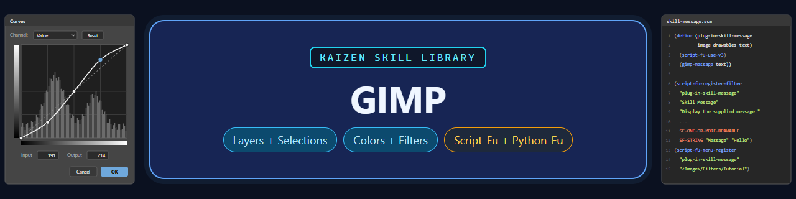

# GIMP Agent Skill



Gives Claude Code, Codex and other coding agents GIMP 3.2 references for image editing and automation: layers, selections, masks, paths, colors and filters, plus Script-Fu, Python-Fu and the Procedural Database (PDB), so they can find the right menu, tool or procedure name before they explain an edit or write a plug-in.

**Status: early draft.** The reference pages and one JPEG conversion script are in place; assets, more scripts and evaluations will be added over time.

## Install

```sh
npx skills add LevyBytes/AI-SKILL-gimp -g
```

This installs the skill as `gimp` for each coding agent it finds on your computer; without `-g` it goes into the current project only. The command needs Node.js 22.20 or later.

<details>
<summary>Install without Node.js</summary>

Clone the repository into your agent's skills folder:

| Agent | Command |
| --- | --- |
| Claude Code | `git clone https://github.com/LevyBytes/AI-SKILL-gimp ~/.claude/skills/gimp` |
| Codex | `git clone https://github.com/LevyBytes/AI-SKILL-gimp ~/.agents/skills/gimp` |

</details>

## Use

Ask your agent about GIMP as usual; it loads the skill when a task matches. You can also call it by name with `/gimp` in Claude Code or `$gimp` in Codex.

- "How do I apply explicit curves to a drawable with `gimp-drawable-curves-explicit`?"
- "How is a Python 3 plug-in registered with `Gimp.PlugIn` in GIMP 3?"
- "When should I use `script-fu-register-filter` instead of the classic `script-fu-register`?"
- "How do I run a Script-Fu command headless with `gimp-console-3.2`?"

## What's inside

Seventeen reference pages and one script.

| Area | Pages | Covers |
| --- | ---: | --- |
| Editing: [interface](references/interface-and-workflow.md), [tools](references/tools-overview.md), [layers and modes](references/layers-and-modes.md), [selections](references/selections.md), [masks and channels](references/masks-and-channels.md), [paths](references/paths.md), [colors](references/colors-and-adjustments.md), [filters](references/filters.md), [file formats](references/file-formats-and-export.md) | 9 | Windows and docks, tool shortcuts, layer groups and blend modes, selections, layer masks and Quick Mask, Bézier paths and SVG, levels, curves and ICC profiles, filter categories, XCF, PNG and JPEG export |
| Scripting: [overview](references/scripting-overview.md), [PDB reference](references/pdb-reference.md), [Script-Fu](references/script-fu.md), [Python-Fu](references/python-fu.md) | 4 | Choosing a language, installing plug-ins, consoles, headless batch runs, PDB names and types, Scheme registration, Python 3 plug-ins with GObject Introspection |
| PDB recipes: [images and layers](references/pdb-recipes-images-layers.md), [selections and paths](references/pdb-recipes-selections-paths.md), [colors and filters](references/pdb-recipes-color-filters.md), [file I/O and batch](references/pdb-recipes-io-batch.md) | 4 | Procedure calls for creating, resizing and flattening, selections and paths, tone and color adjustments, saving, exporting and batch processing |

| Script | What it does |
| --- | --- |
| [`scripts/convert_to_jpeg.py`](scripts/convert_to_jpeg.py) | Converts one image to a new JPEG through a headless GIMP 3.2: flattens onto white, never modifies the source and refuses an existing destination. Needs GIMP 3.2 with `gimp-console-3.2` and Python 3.8 or later to launch it. |

Match examples to the installed GIMP version and its procedures. Running an edit or a script needs a GIMP installation or a separately configured integration such as an MCP server; the skill does not bundle one.

## When agents load this skill

Use for GIMP 3.2 raster editing and generation; layers, blend modes, masks, channels, selections and Bezier paths; tools, filters, colors, levels, curves and ICC profiles; XCF, PNG and JPEG import/export; or Script-Fu, Python-Fu, Script-Fu Console and PDB automation, including GIMP MCP and headless/batch runs. Also use for .xcf files, gimp-* procedures, script-fu-register, gi.repository.Gimp and GObject-Introspection plug-ins without an explicit GIMP mention.

## The work behind the references

Manual and scripting material is reorganized around editing tasks and API use. Separate recipe references keep image/layer operations, selections, color processing and batch file handling together without burying their prerequisites in a single long document.

## Contributing

Pull requests are accepted from approved contributors only. To propose a fix or a feature, first open an issue that describes the change your pull request would make, such as a PDB procedure name that changed in a GIMP release and the GIMP documentation it should match. The maintainer reviews the issue and your GitHub account, then approves or declines. New maintainers are approved the same way. See [CONTRIBUTING](.github/CONTRIBUTING.md).

## Sources and license

Skill reference documentation is interpreted content for use in open source projects. Check against [official documentation sources](https://docs.gimp.org/) when dealing with defects or issues that may come up from interpreting this skill's references.

Licensed under **Apache-2.0**; see [LICENSE](LICENSE). Part of the [Agent Kaizen](https://github.com/LevyBytes/agent-kaizen) skill library.
