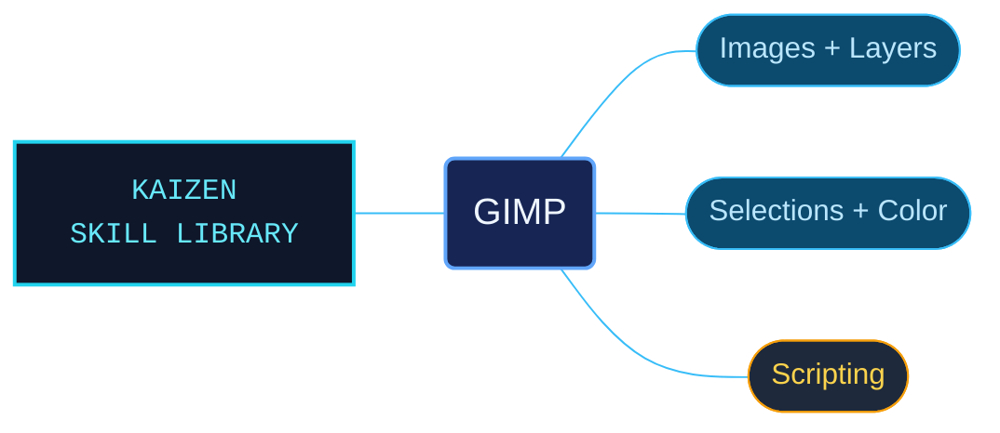

# GIMP

GIMP 3.2 references for image editing and scripted workflows. Editing concepts, tools and file handling sit alongside Script-Fu, Python-Fu and procedural database guidance, helping an agent connect a visual task with the relevant controls or API calls.

Use for GIMP 3.2 raster editing and generation; layers, blend modes, masks, channels, selections and Bezier paths; tools, filters, colors, levels, curves and ICC profiles; XCF, PNG and JPEG import/export; or Script-Fu, Python-Fu, Script-Fu Console and PDB automation, including GIMP MCP and headless/batch runs. Also use for .xcf files, gimp-* procedures, script-fu-register, gi.repository.Gimp and GObject-Introspection plug-ins without an explicit GIMP mention.

## What this skill helps with

| Task | Useful reference material |
| --- | --- |
| [Choose editing tools](references/tools-overview.md) | Find the tools and interaction patterns relevant to a raster-editing task. |
| [Build layered images](references/layers-and-modes.md) | Work with layers and blend modes, with linked selection, mask and channel guidance. |
| [Adjust color and tone](references/colors-and-adjustments.md) | Look up adjustments and color-management concepts before applying changes. |
| [Automate repeatable work](references/scripting-overview.md) | Select Script-Fu or Python-Fu guidance and follow linked PDB references and recipes. |

## The work behind the references

Manual and scripting material is reorganized around editing tasks and API use. Separate recipe references keep image/layer operations, selections, color processing and batch file handling together without burying their prerequisites in a single long document.

## Start here

Start with [SKILL.md](SKILL.md) and follow its context routes.

Match examples to the installed GIMP version and its available procedures. The package supplies reference guidance; executing an edit or script requires a GIMP installation or a separately configured integration.

## Sources and license

Skill reference documentation is interpreted content for use in open source projects. Check against [official documentation sources](https://docs.gimp.org/) when dealing with defects or issues that may come up from interpreting this skill's references.

Licensed under **AGPL-3.0**; see [LICENSE](LICENSE). Part of the [Agent Kaizen](https://github.com/LevyBytes/agent-kaizen) skill library.
